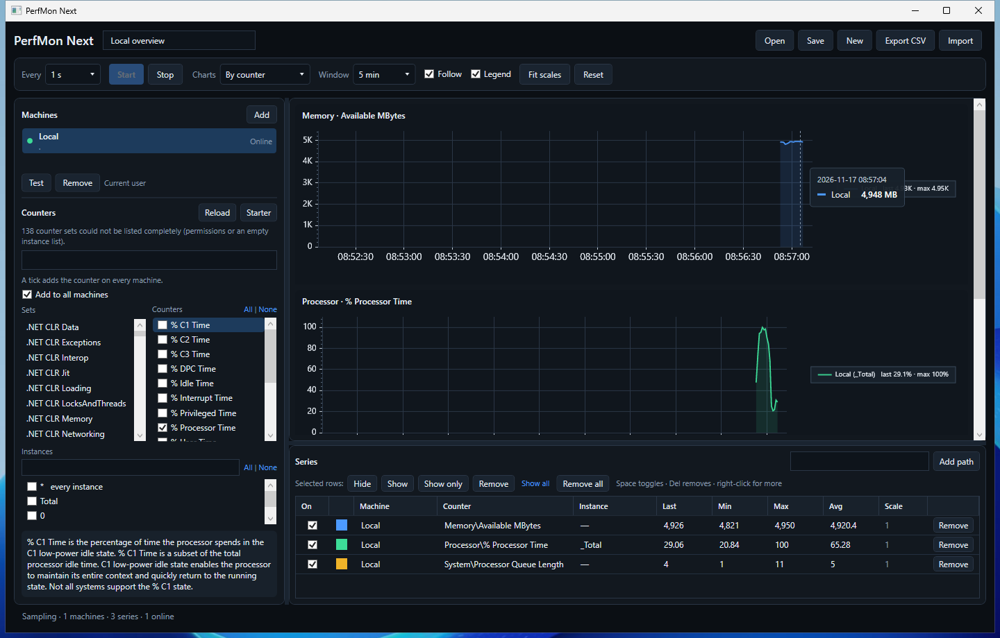
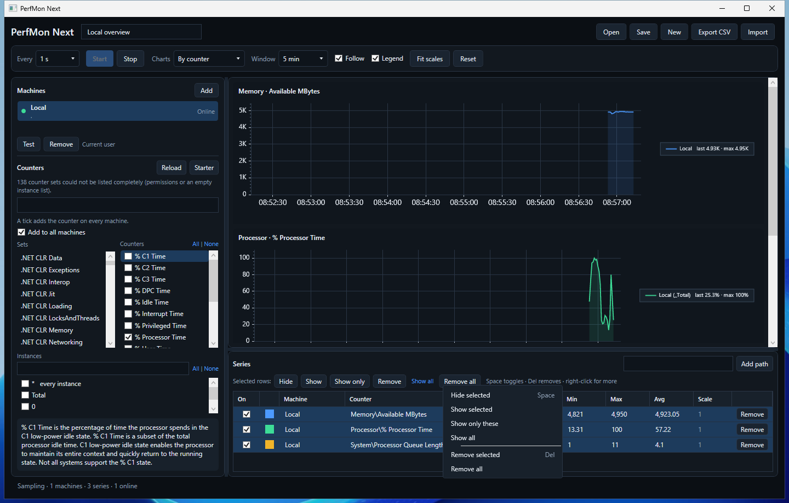

# PerfMon Next user guide

This guide walks through the desktop app that ships in [Releases](https://github.com/EquiByteCZ/perfmon-next-releases/releases). Download `PerfMonNext-win-x64.zip`, unzip it, and run `PerfMonNext.exe`. The executable is signed by EquiByte s.r.o.; see the [README](../README.md#signing-and-smartscreen) if Windows SmartScreen appears.

## Main window

The window is dark. The left pane is the machine list and the counter picker. The right pane is live charts and a series table (last, min, max, average, and scale).

Along the top you can name the workspace, then **Open**, **Save**, **New**, **Export CSV**, and **Import**. The next bar sets the sample interval, **Start** / **Stop**, **Charts** (**By counter**, **By machine**, **Combined**, or **Table only**), the visible time window, **Follow**, **Legend**, **Fit scales**, and **Reset**.

Keyboard shortcuts:

- **F5** — start sampling
- **Ctrl+S** — save workspace
- **Ctrl+O** — open workspace

A new session starts with a **Local overview** workspace: this computer (`.`) and `Processor\% Processor Time` (`_Total`), `Memory\Available MBytes`, and `System\Processor Queue Length`. Press **Start** or **F5**. Rate counters show a value on the second interval.

**Follow** keeps the time axis on the latest samples. Turn it off, then drag to pan and use the wheel to zoom.

The Y axis starts at 0 for counters that never go negative, with a little headroom above the peak. It only goes below 0 when a series really has negative values. Large values are labelled compactly (for example 250K or 1.2G).

### Hover

Point at a chart and a dashed crosshair follows the mouse. A card shows the sample time and, for every series on that chart, its color, name, and value at the nearest sample. Values are always real (never scaled). Numbers under 10,000 are shown in full; bigger ones are shown compactly, followed by the full number, for example `12.3M B/s (12,345,678)`. A unit is added when the counter name implies one (`B/s` for Bytes/sec, `%`, `MB`, `/s`). The card snaps to the nearest sample, so if you point at a gap before the first sample it shows that first sample and its time.

### Fit scales and Reset

Each series has a display **Scale** factor (default 1). It only changes how the line is drawn. The series table, the hover card, and CSV export always show real values.

**Fit scales** is for charts that mix series of very different size, for example a busy and an idle network adapter in one chart. It magnifies the smaller series by a power of ten (×10, ×1000, …) so they are visible next to the largest one, which stays ×1 so the axis keeps real units. A chart with one series, or with series within 10× of each other, is not changed, and the status bar says so. A scaled series shows its factor in two places: the legend (for example `node01 ×1000`) and the highlighted **Scale** column. You can also type a factor there, such as `0.001` or `1e-6`.

**Reset** puts everything back to the default view: every scale factor back to 1, every hidden series shown again, zoom and pan cleared (Y from 0 again), and **Follow** turned on. It does not remove series or machines.

**Legend** shows a compact legend to the right of each chart: up to six entries, each with its last and max value, then "+N more". Uncheck it to hide the legend on every chart; the colors stay visible in the series table.

**Charts → Table only** turns the charts off and gives the whole right pane to the series table. Sampling, statistics, and CSV export keep working. Use it when you watch many counters and only need the numbers. Pick a grouping again to bring the charts back.

## Series table

Every counter instance you collect is one row with its color, machine, counter, instance, and last / min / max / average values. The **On** box shows or hides a single series on the charts; hidden series keep collecting.

Select several rows with Shift-click or Ctrl-click (or **Ctrl+A**), then use the buttons above the table or the right-click menu:

- **Hide** / **Show**: hide or show the selected series on the charts.
- **Show only** (**Show only these** in the menu): show the selection and hide every other series.
- **Show all**: make every series visible again.
- **Remove**: stop collecting the selected series.
- **Remove all**: remove every counter and series at once and untick everything in the picker, so you can start a fresh selection. The machines list is not changed. If more than three series would go, PerfMon Next asks first.

Keys in the table: **Space** toggles the selection (if any selected series is visible, they are all hidden; otherwise they are all shown) and **Delete** removes it. Click the color swatch to cycle a series color, and type into **Scale** to set a display factor (see [Fit scales and Reset](#fit-scales-and-reset)).

## Counter picker

The left pane has:

- **Machines** — **Add** a host (`.` is this computer), **Test** connectivity, or **Remove** a machine. Optional alternate credentials can be remembered on this PC. Type a failover **cluster name** and all of its nodes are added at once; there is no separate option to tick.
- **Counters** — **Reload** reads the catalog from the selected machine. **Starter** shows a built-in subset (processor, memory, disk, Hyper-V, CSV, SMB) when a remote catalog is slow or down. The search box filters sets, counters, instances, and help text.
- **Add to all machines** — one tick creates the counter on every machine. Clear it to target only the selected machine.
- **Sets**, **Counters**, and **Instances** lists — tick a counter (and an instance when the set is multi-instance) to add it. Multi-instance counters accept `*` (every instance, expanded while sampling) or a prefix such as `chrome*`. `_Total` is the default when that instance exists.
- Bulk selection — **All** / **None** above the Counters and Instances lists tick or untick everything shown. Shift-click a second item to tick the whole range, or press **Ctrl+A** in a list. Type into the instance filter (for example `Hv VP` or a VM name), then click **All** to tick only the matches.
- Explain text appears at the bottom when you select a counter.

You can also paste a path such as `\Processor(_Total)\% Processor Time` or `\\node02\Memory\Available MBytes` into **Add path** under the series table. A path that names a computer adds that computer.

Selecting a counter set loads that set's counters and instances from the machine (a fresh category sample, a PDH instance enumeration, and `GetInstanceNames`). This matters for remote multi-instance sets such as Hyper-V Hypervisor Logical Processor, where a bulk catalog query often returns no instances. If instances still cannot be listed, an error and a **Retry** button appear instead of "(single instance)". When a sample cannot be read, the series table shows the error in the Last column rather than "—".

## Remote machines

See the [README](../README.md#adding-remote-machines) for the required services, firewall groups, and the **Performance Monitor Users** group. After a machine is added, **Test** is the fastest way to confirm the account can read counters.

## Saving work and exchanging data

- **Workspace JSON** stores machines, selected counters, interval, history length, chart grouping, colors, scales, and visibility — not passwords.
- **Export CSV** writes `timestamp,machine,category,counter,instance,value`.
- **Import** accepts that CSV, PDH-CSV from `relog -f CSV`, and on Windows a `.blg` log (converted with `relog.exe`).

Hyper-V and CSV counters exist only when those roles are installed; a missing counter is reported on that machine and the others continue.
