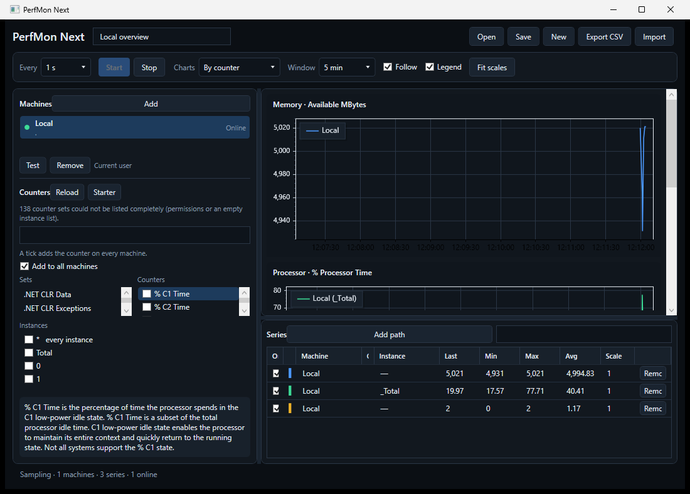
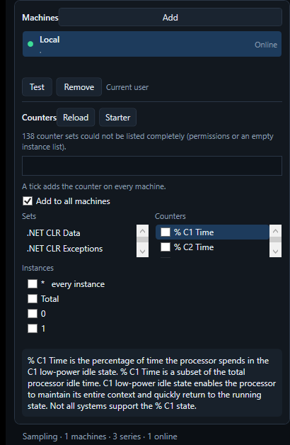

# PerfMon Next user guide

This guide walks through the desktop app that ships in [Releases](https://github.com/EquiByteCZ/perfmon-next-releases/releases). Download `PerfMonNext-win-x64.zip`, unzip it, and run `PerfMonNext.exe`. The executable is signed by EquiByte s.r.o.; see the [README](../README.md#signing-and-smartscreen) if Windows SmartScreen appears.

## Main window

The window is dark. The left pane is the machine list and the counter picker. The right pane is live charts and a series table (last, min, max, average, and scale).

Along the top you can name the workspace, then **Open**, **Save**, **New**, **Export CSV**, and **Import**. The next bar sets the sample interval, **Start** / **Stop**, chart grouping (**By counter**, **By machine**, or **Combined**), the visible time window, **Follow**, **Legend**, and **Fit scales**.

Keyboard shortcuts:

- **F5** — start sampling
- **Ctrl+S** — save workspace
- **Ctrl+O** — open workspace

A new session starts with a **Local overview** workspace: this computer (`.`) and `Processor\% Processor Time` (`_Total`), `Memory\Available MBytes`, and `System\Processor Queue Length`. Press **Start** or **F5**. Rate counters show a value on the second interval.

**Follow** keeps the time axis on the latest samples. Turn it off, then drag to pan and use the wheel to zoom. **Fit scales** picks a power-of-ten factor so each series lands near 10–100. The scale is for display only; CSV export stores raw values.

## Counter picker

The left pane has:

- **Machines** — **Add** a host (`.` is this computer), **Test** connectivity, or **Remove** a machine. Optional alternate credentials can be remembered on this PC.
- **Counters** — **Reload** reads the catalog from the selected machine. **Starter** shows a built-in subset (processor, memory, disk, Hyper-V, CSV, SMB) when a remote catalog is slow or down. The search box filters sets, counters, instances, and help text.
- **Add to all machines** — one tick creates the counter on every machine. Clear it to target only the selected machine.
- **Sets**, **Counters**, and **Instances** lists — tick a counter (and an instance when the set is multi-instance) to add it. Multi-instance counters accept `*` (every instance, expanded while sampling) or a prefix such as `chrome*`. `_Total` is the default when that instance exists.
- Explain text appears at the bottom when you select a counter.

You can also paste a path such as `\Processor(_Total)\% Processor Time` or `\\node02\Memory\Available MBytes` into **Add path** under the series table. A path that names a computer adds that computer.

Selecting a counter set loads that set's counters and instances from the machine (a fresh category sample, a PDH instance enumeration, and `GetInstanceNames`). This matters for remote multi-instance sets such as Hyper-V Hypervisor Logical Processor, where a bulk catalog query often returns no instances. If instances still cannot be listed, an error and a **Retry** button appear instead of "(single instance)". When a sample cannot be read, the series table shows the error in the Last column rather than "—".

## Remote machines

See the [README](../README.md#adding-remote-machines) for the required services, firewall groups, and the **Performance Monitor Users** group. After a machine is added, **Test** is the fastest way to confirm the account can read counters.

## Saving work and exchanging data

- **Workspace JSON** stores machines, selected counters, interval, history length, chart grouping, colors, scales, and visibility — not passwords.
- **Export CSV** writes `timestamp,machine,category,counter,instance,value`.
- **Import** accepts that CSV, PDH-CSV from `relog -f CSV`, and on Windows a `.blg` log (converted with `relog.exe`).

A sample three-node workspace (CPU, memory, queue, Hyper-V logical processor, CSV read latency) ships with the source repository as `samples/azure-local-cluster.workspace.json`. Change the host names before you start it. Hyper-V and CSV counters exist only when those roles are installed; a missing counter is reported on that machine and the others continue.
